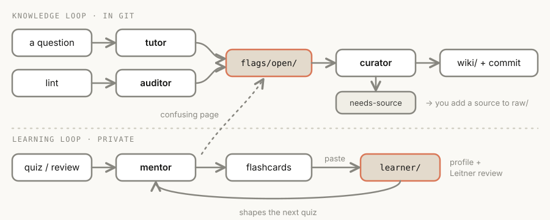

# knowledge-factory

A personal wiki that maintains itself. Claude Code agents compile your
sources into linked markdown pages, flag what's missing instead of guessing,
fix the wiki from the sources, and quiz you on it with flashcards that adapt
to how you learn.

It combines Andrej Karpathy's
[LLM Wiki](https://gist.github.com/karpathy/442a6bf555914893e9891c11519de94f)
pattern with the "knowledge factory" idea from Harrison Chase's post
[How to build a knowledge factory](https://www.langchain.com/blog/knowledge-factory)
(summarized in [`wiki/topics/knowledge-factory.md`](wiki/topics/knowledge-factory.md)):
the agents that **use** knowledge never **maintain** it.



## Why

Most agent failures come from missing knowledge, not a bad model. A RAG
pipeline rereads your documents on every query and forgets; a wiki compiles
them once and keeps the synthesis. But a wiki rots unless something notices
the gaps and fixes them. Here, every gap becomes a **flag**, and one agent's
only job is to close flags using your sources.

## The agents

You only talk to the main session. It orchestrates: it plans, gets your
approval, hands each task to its agent, reviews every commit and reports
back. It doesn't write pages or commit itself.

| | Tutor | Auditor | Curator | Mentor | Archivist |
|---|---|---|---|---|---|
| Runs when | You ask a question | The wiki gets checked | Flags get fixed, or pages get written | You want a quiz or a review | A source enters `raw/` |
| Looks at | The pages it needs | The whole wiki | Open flags and `raw/` | The wiki and your profile | Your material and `raw/` |
| Produces | An answer that cites pages, plus a flag if something's off | Only flags | Fixes, pages, a commit | Flashcards, grading, an updated profile | The source filed and listed in `raw/SOURCES.md`, a commit |
| Edits the wiki | No | No | Yes | No | No |

Hooks in `.claude/hooks/` enforce these limits: the tutor, auditor and
mentor physically can't write outside their folders, the curator can't
touch your sources, and the archivist can file them but never edit,
overwrite or delete them. Every change is an unsigned Conventional Commit.

Models are split by job: the main session leads (plans, delegates, reviews
every commit), `Explore` and the archivist run on Haiku, and the tutor,
auditor, curator and mentor on Sonnet. See "Models and delegation" in
`AGENTS.md`.

## Learning with the mentor


1. `quiz rag` (or `review` for what's due today) builds 4–8 cards from the
   wiki pages only, and opens them in your browser.
2. You answer, reveal, and grade yourself.
3. At the end you copy the results and paste them in the chat.
4. The mentor grades your free-text answers, updates your profile
   (interests, strengths, struggles, how you learn best — each fact backed
   by evidence) and schedules the next review with Leitner boxes (1, 3, 7,
   14 and 30 days).

If a card trips you up because the page itself is unclear, the mentor
raises a flag about the page and the curator fixes it.

**Your learning data stays on your machine.** Everything in `learner/` and
`wiki/qa/` except their README is in `.gitignore`. Flags are private too:
they're the factory's own working notes, describe gaps in the wiki (never
your questions) and stay out of git.

## Quick start

**Requirements:** [Claude Code](https://docs.anthropic.com/en/docs/claude-code).
[Obsidian](https://obsidian.md) is optional but recommended for browsing the
wiki and its graph.

1. Click **Use this template** on GitHub (make the copy private if you
   need to). It then evolves on its own: there is no sync with the template.
2. Clone your copy and run `claude` in it.
3. Claude welcomes you and guides you: explore the sample content first, or
   start your own wiki. The reset asks for the language and titles, so you
   never edit `wiki.config.md` by hand. Then say what you want to learn, e.g.
   "I want to learn RAG"; you approve one plan and Claude runs every agent.
   `/wiki-help` shows what you can say and what's pending.

**Obsidian setup (optional):** open the folder as a vault, set *Settings →
Files and links → Default location for new attachments* to `raw/assets`, and
bind *Download attachments for current file* to a hotkey (e.g. `Cmd+Shift+D`)
so web clippings keep their images locally.

## Using it

No commands: you write in plain words and the main session runs the agents.

| You write | What happens |
|---|---|
| "I want to learn RAG", "here's a RAG course" | One plan to approve, then wiki pages, checks, a visual summary and a quiz |
| A question | The tutor answers from the wiki and cites pages |
| Your pasted quiz results | The mentor grades them and schedules reviews |
| "Quiz me", "check the wiki", a video link… | The matching agent runs |

## Structure

```
raw/          Sources (articles/ papers/ repos/ assets/) + SOURCES.md
wiki/         entities/ topics/ comparisons/ timelines/ qa/ (private) assets/
artifacts/    Visual HTML summaries
flags/        open/ closed/ (private) TEMPLATE.md
learner/      Your learning profile (private)
.claude/      agents/ hooks/ commands/
AGENTS.md     The schema every agent follows
wiki.config.md  Settings for this repo (language, section titles)
index.md · videos.md
```

## Sample content

The wiki ships with nine pages and four diagrams compiled from two articles:

- [RAG vs. Agent Memory vs. LLM Wiki: A Practical Comparison](https://dev.to/vishalmysore/rag-vs-agent-memory-vs-llm-wiki-a-practical-comparison-1oo6) by vishalmysore
- [How to build a knowledge factory](https://www.langchain.com/blog/knowledge-factory) by Harrison Chase

The articles themselves aren't included, because their licenses don't allow
redistribution: they're listed as **link-only** sources in `raw/SOURCES.md`.
Download them into `raw/articles/` if you want the agents to work with them.

Asking Claude to start your own wiki removes it (`LICENSE-content` stays for
you to adjust).

## License

- Framework (schema, agents, hooks, commands, docs): [MIT](LICENSE).
- Sample wiki content (`wiki/`, `artifacts/`, `docs/`): [CC BY 4.0](LICENSE-content).
- Sources in `raw/` keep their own licenses, listed in `raw/SOURCES.md`.

Artifact visual style inspired by
[html-effectiveness](https://thariqs.github.io/html-effectiveness/).
