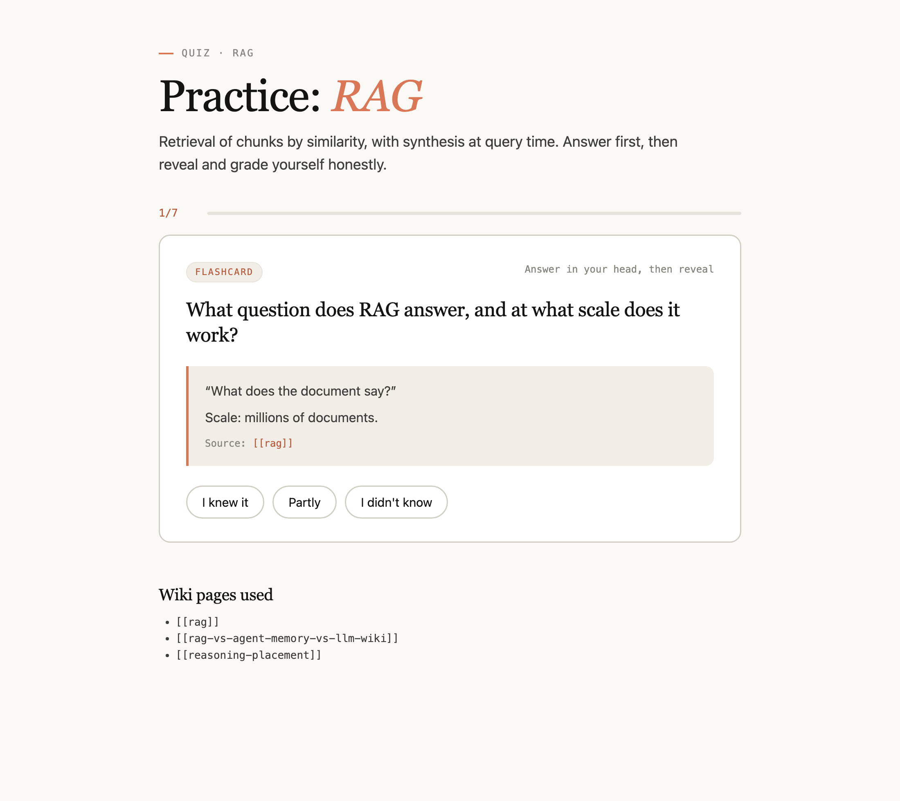

# knowledge-factory

A personal wiki that maintains itself. Claude Code agents compile your
sources into linked markdown pages, flag what's missing instead of guessing,
fix the wiki from the sources, and quiz you on it with flashcards that adapt
to how you learn. It combines Andrej Karpathy's
[LLM Wiki](https://gist.github.com/karpathy/442a6bf555914893e9891c11519de94f)
pattern with Harrison Chase's
[knowledge factory](https://www.langchain.com/blog/knowledge-factory) idea
(see [`wiki/topics/knowledge-factory.md`](wiki/topics/knowledge-factory.md)):
the agents that **use** knowledge never **maintain** it.

## Quick start

**Requirements:** [Claude Code](https://docs.anthropic.com/en/docs/claude-code).
[Obsidian](https://obsidian.md) is optional, to browse the wiki and its graph.

1. Click **Use this template** on GitHub (private if you need to).
2. Clone your copy and run `claude` in it.
3. Write anything (e.g. "hello"): Claude guides you through the sample
   content or starts your own wiki. Then say what you want to learn.
   `/wiki-help` shows what you can say and what's pending.

## What you can say

No commands: you write in plain words and the main session runs the agents.

| You write | What happens |
|---|---|
| "I want to learn RAG", "here's a RAG course" | One plan to approve, then wiki pages, checks, a visual summary and a quiz |
| A question | The tutor answers from the wiki and cites pages |
| "Quiz me", then your pasted results | The mentor grades them and schedules reviews |
| "Check the wiki", a video link… | The matching agent runs |

The rules every agent follows are in [`AGENTS.md`](AGENTS.md).

## Privacy

Your learning data (`learner/`), private answers (`wiki/qa/`) and the flags
stay on your machine: they are in `.gitignore` and never committed.

## License

- Framework (schema, agents, hooks, commands, docs): [MIT](LICENSE).
- Sample wiki content (`wiki/`, `artifacts/`, `docs/`): [CC BY 4.0](LICENSE-content).
- Sources in `raw/` keep their own licenses, listed in `raw/SOURCES.md`.
